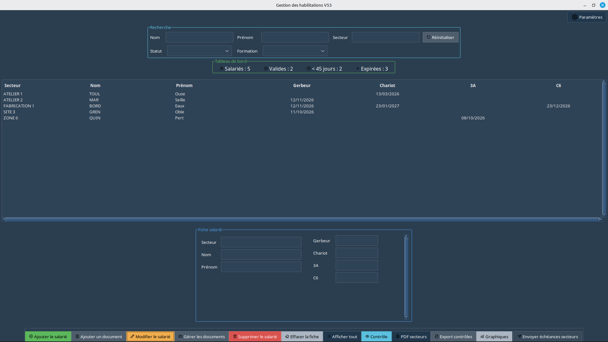
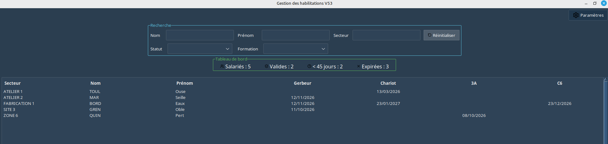
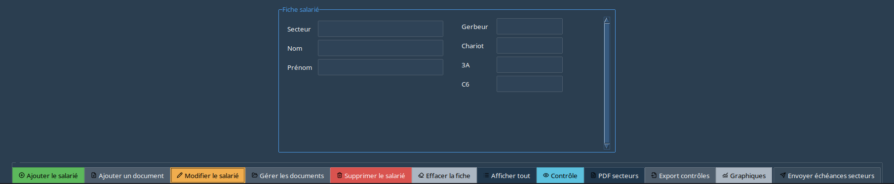
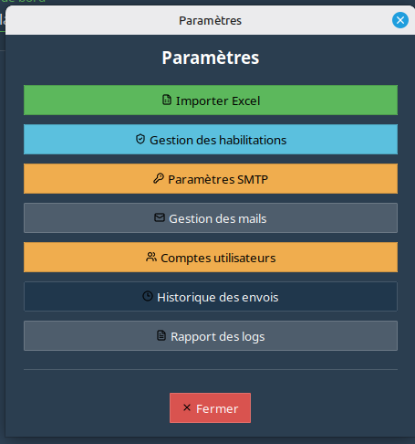
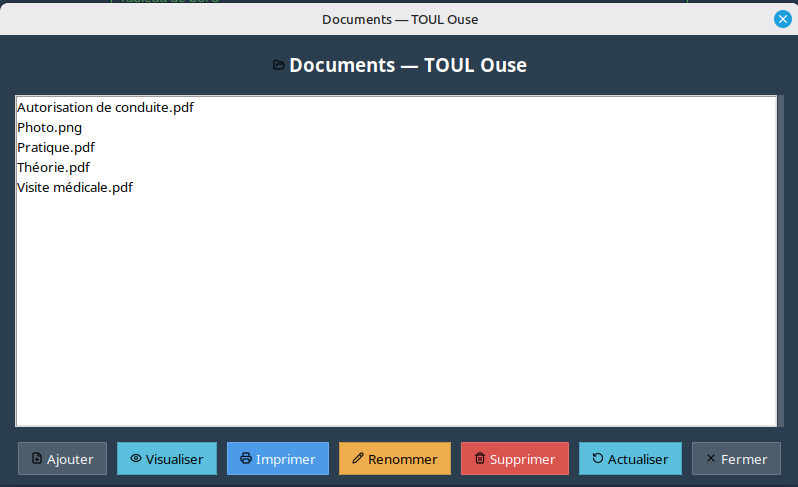
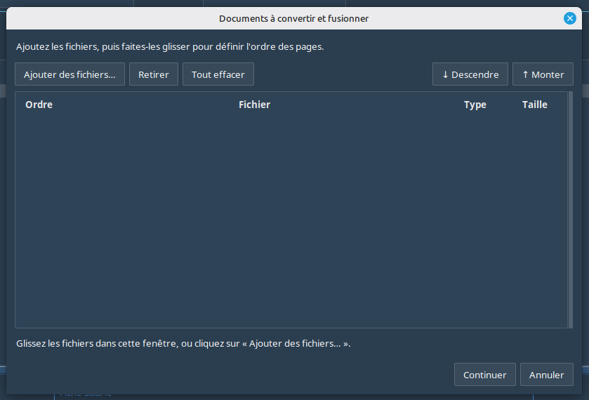
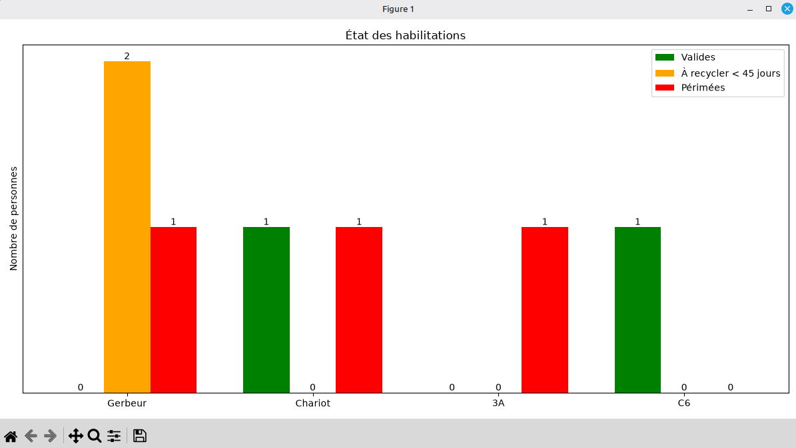
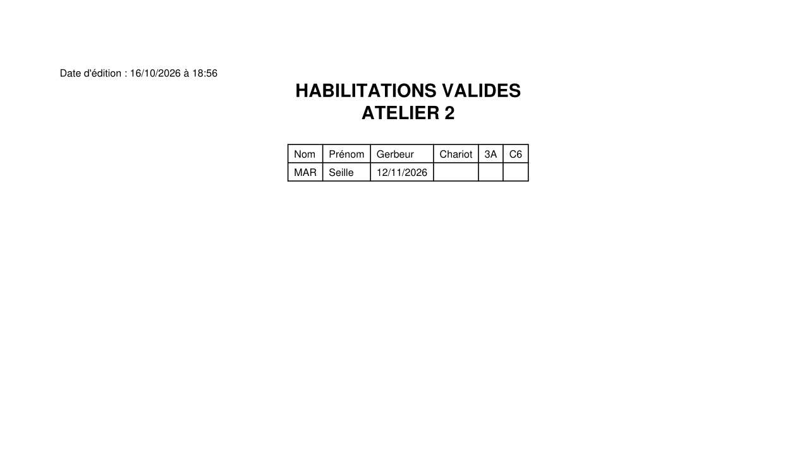

# Gestion des habilitations

Application de bureau Python pour gérer les habilitations du personnel, suivre leurs échéances et organiser les documents associés aux salariés.

> **État du projet :** V54 — préparation à la publication. L'application a été lancée avec succès sous Linux Mint et les vérifications techniques préliminaires ont été effectuées. Les tests fonctionnels complets et le packaging restent à finaliser.

## Fonctionnalités principales

- Gestion des salariés et de leurs habilitations.
- Stockage des données dans une base SQLite.
- Import et export Excel.
- Contrôle des dates d'échéance et statistiques.
- Génération de PDF et de graphiques.
- Gestion de documents associés aux salariés, dont la fusion de documents PDF.
- Gestion des paramètres d'envoi de courriels et des comptes utilisateurs.

## Prérequis

- Python 3.10 ou plus récent recommandé.
- Tkinter installé pour la version de Python utilisée. Sous Linux, Tkinter peut devoir être installé par le gestionnaire de paquets de la distribution.
- Les dépendances Python listées dans `requirements.txt`.

## Installation depuis les sources

1. Clonez le dépôt.
2. Créez et activez un environnement virtuel.
3. Installez les dépendances.
4. Lancez l'application.

Exemple sous Linux :

```bash
git clone <URL_DU_DEPOT>
cd <DOSSIER_DU_DEPOT>
python3 -m venv .venv
source .venv/bin/activate
python -m pip install --upgrade pip
python -m pip install -r requirements.txt
python main.py
```

Sous Windows, créez l'environnement avec `py -m venv .venv`, activez-le avec `.venv\\Scripts\\activate` puis installez `requirements.txt` avec `py -m pip install -r requirements.txt`. Lancez ensuite `py main.py`.

## Données et confidentialité

L'application utilise des données professionnelles potentiellement personnelles. Ne publiez jamais une base SQLite réelle, des fichiers Excel contenant des salariés, des documents, des journaux, des exports ou des identifiants de messagerie.

La version candidate V54 place les données persistantes dans le répertoire de données de l'utilisateur :

- Linux : `~/.local/share/GestionHabilitations/` par défaut (ou `$XDG_DATA_HOME/GestionHabilitations/` si `XDG_DATA_HOME` est défini).
- Windows : `%LOCALAPPDATA%\\GestionHabilitations\\`.

Les fichiers de données ne doivent pas être versionnés dans Git. Le fichier `.gitignore` exclut les principaux dossiers de données et fichiers locaux.

## Courriels et identifiants

Ne stockez pas de mots de passe, jetons ou secrets dans le code source ou dans le dépôt. L'application utilise `keyring` pour le stockage sécurisé des identifiants SMTP lorsque le système le permet. Vérifiez la configuration du trousseau de clés sur chaque poste.

## Construction d'exécutables

Le packaging avec PyInstaller est prévu, mais les exécutables Windows et Linux doivent être construits et testés sur leurs systèmes cibles respectifs. La liste de dépendances de construction se trouve dans `requirements-build.txt`.

## Tests

La vérification de syntaxe Python ne remplace pas les tests fonctionnels. Avant toute publication, tester notamment la première création de compte administrateur, la connexion, l'import/export, les sauvegardes, la génération PDF/graphiques, les courriels et l'accès aux documents salariés.

## Captures d'écran

Les captures suivantes présentent l'interface de Gestion des habilitations V54 et ses principales fonctionnalités.

### Fenêtre principale



### Recherche, tableau de bord et tableau des salariés



### Fiche salarié et boutons d'action



### Paramètres de l'application



### Gestion des documents



### Ajouter un document



### Graphique des habilitations



### Export PDF par secteur



## Licence

Le projet est distribué sous la [PolyForm Noncommercial License 1.0.0](https://polyformproject.org/licenses/noncommercial/1.0.0). Cette licence encadre les usages non commerciaux selon ses conditions. Consultez le fichier `LICENSE` pour le texte intégral.
